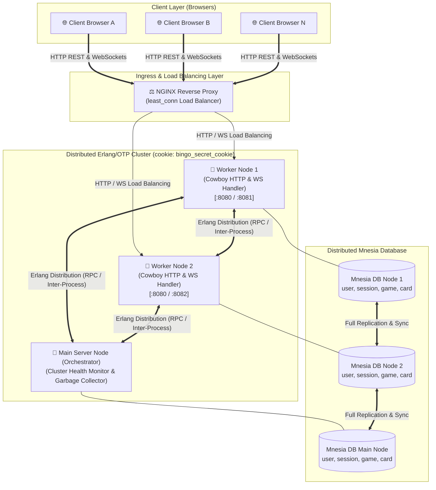
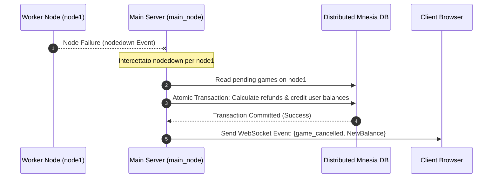

# 🎯 Distributed Real-Time Bingo Platform

[](https://www.erlang.org/)
[](https://erlang.org/doc/man/mnesia.html)
[](https://github.com/ninenines/cowboy)
[](https://nginx.org/)
[](#)

> **High-Availability, Fault-Tolerant, Multi-Node Real-Time Engine in Erlang/OTP**  
> *Sviluppato come progetto per il corso di Distributed Systems and Middleware Technologies (DSMT) – Università di Pisa.*

---

## 📌 Executive Summary

Questo repository racchiude l'implementazione di una piattaforma distribuita di **Bingo / Tombola Multiplayer in tempo reale**, ingegnerizzata secondo il paradigma dell'**Actor Model** in Erlang/OTP. 

Il sistema gestisce la presenza simultanea di molteplici giocatori concorrenti attraverso connessioni **WebSocket ad altissima frequenza**, garantendo al contempo:
- **Consistenza dei Dati (ACID)** tramite cluster distribuito Mnesia.
- **Resilienza e Tolleranza ai Guasti (Fault Tolerance)** con autoriparazione e ripristino atomico dello stato in caso di crash dei nodi.
- **Scalabilità Orizzontale** mediante bilanciamento dinamico del carico su proxy NGINX.
- **Sicurezza di Grado Enterprise** con hashing crittografico delle credenziali (PBKDF2-HMAC-SHA256) e gestione sicura delle sessioni via cookie HTTP-Only.

---

## 🛠️ Tech Stack & Pillars Architetturali

| Componente | Tecnologia | Ruolo e Pattern Implementativi |
| :--- | :--- | :--- |
| **Core Engine** | `Erlang/OTP` | Concorrenza basata su Actor Model, supervisor, `gen_server` isolati per ogni stanza di gioco. |
| **Distributed DB** | `Mnesia DB` | Database distribuito multi-nodo a memoria condivisa/disco con supporto a transazioni ACID atomiche. |
| **Web Server & WS** | `Cowboy` | HTTP REST API per auth & WebSocket server ad alte prestazioni per la comunicazione duplex real-time. |
| **Load Balancer** | `NGINX` | Reverse proxy con algoritmi `least_conn` e gestione trasparente dei protocolli WebSocket (`Upgrade`). |
| **JSON Processor** | `jsx` | Data serialization/deserialization ultra-veloce per i payload di rete Erlang-Client. |
| **Frontend UI** | `HTML5 / CSS3 / ES6+` | Client reattivo Vanilla JavaScript privo di dipendenze esterne con rendering ottimizzato della griglia. |

---

## 📐 Architettura del Sistema

L'architettura è suddivisa in **3 layer disaccoppiati**: Client Layer, Ingress/Proxy Layer e Distributed Core Cluster.

### 🌐 System Topology Diagram



---

## 🔬 Highlights Ingegneristici e Decisioni Progettuali

### ⚡ 1. Concorrenza basata su Actor Model (`gen_server`)
Ogni partita di Bingo attiva nel sistema viene istanziata come un **processo Erlang isolato** (`game_server`), registrato a livello globale tramite `global:register_name(GameId, self())`.
- **Isolamento dei guasti**: Se il processo di una singola partita incontra un'anomalia, l'evento non impatta in alcun modo gli altri game_server né il resto del cluster.
- **Stato incapsulato**: Lo stato della partita (giocatori, cartelle vendute, montepremi, numeri estratti, combinazioni vincenti registrate) viene gestito internamente in modalità thread-safe.

### 🛡️ 2. Tolleranza ai Guasti & Disaster Recovery (Atomic Refund)
Il nodo centrale (`main_server`) attiva un monitoraggio continuo dello stato di salute del cluster tramite `net_kernel:monitor_nodes(true)`.

**Scenario di Crash di un Nodo Worker (`nodedown`)**:
1. Il `main_server` intercetta l'evento di caduta del nodo.
2. Identifica in modo atomico le stanze in attesa di inizio presenti sul nodo caduto.
3. Avvia una **transazione Mnesia transazionale** che:
   - Calcola il rimborso esatto per ciascun giocatore in base alle cartelle acquistate (10 monete/cartella).
   - Accredita le monete rimborsate direttamente sul saldo del record `user`.
   - Elimina la partita dal database ed invia ai client connessi la notifica di cancellazione con il saldo aggiornato.



### 💾 3. Modello Dati Distribuito (Mnesia DB Strategy)
Il database Mnesia è strutturato sfruttando due strategie di persistenza complementari per ottimizzare throughput e durabilità:

| Tabella | Tipo Schema | Strategia di Persistenza | Rationale |
| :--- | :--- | :--- | :--- |
| `user` | `disc_copies` | Persistente su Disco | Garantisce la persistenza a lungo termine di credenziali, password hash e saldi monete. |
| `session` | `ram_copies` | In-Memory Replicato | Accesso ad altissima velocità per la validazione di ogni richiesta HTTP/WebSocket. |
| `game` | `ram_copies` | In-Memory Replicato | Stato di gioco volatile e dinamico, sincronizzato in tempo reale tra tutti i nodi del cluster. |
| `card` | `ram_copies` | In-Memory Replicato | Griglie delle cartelle per partita, eliminate automaticamente al termine del gioco. |

### 🔐 4. Auth & Security Pipeline
- **Password Hashing**: Implementazione di **PBKDF2-HMAC-SHA256** con 10,000 iterazioni e salt casuale a 16 byte (`crypto:pbkdf2_hmac`).
- **Session Tokens**: Generazione di token crittograficamente forti a 128-bit convertiti in Base64.
- **HTTP-Only Cookies**: I token di sessione vengono scambiati tramite cookie `Set-Cookie` impostati con flag `HttpOnly` per neutralizzare attacchi di tipo XSS.
- **Automatic Garbage Collection**: Un processo periodico sul `main_node` esegue una scansione Mnesia fold per eliminare le sessioni non attive da oltre 24 ore.

---

## 🎯 Regole del Gioco e Convalida Server-Side

La tombola rispetta le regole tradizionali con verifiche di consistenza ad ogni estrazione:

1. **Cartelle**: Ogni cartella possiede una griglia 3x5 (15 numeri unici compresi tra 1 e 90).
2. **Montepremi (*Pot*)**: Ogni cartella costa **10 monete**. Il 100% dell'importo speso confluisce nel montepremi della partita.
3. **Flusso di Gioco**:
   - Fase di attesa (*Lobby*) → Acquisto Cartelle → *Ready Check* da parte di tutti i giocatori → Countdown iniziale → Inizio Estrazione (1 numero ogni $N$ secondi).
4. **Gerarchia Combinazioni**:
   - **Ambo**: 2 numeri estratti sulla stessa riga.
   - **Terno**: 3 numeri estratti sulla stessa riga.
   - **Quaterna**: 4 numeri estratti sulla stessa riga.
   - **Cinquina**: 5 numeri estratti sulla stessa riga.
   - **Tombola / Bingo**: Tutti i 15 numeri della cartella estratti.
5. **Anti-Double Claim**: Il `game_server` traccia nel record `#game.won_combinations` tutte le combinazioni già assegnate per evitare rivendicazioni duplicate dello stesso premio all'interno della medesima partita.

---

## 🗂️ Struttura della Codebase

```text
DSMT-BingoGame/
├── client/                     # Frontend Application Layer
│   ├── index.html              # UI Web reattiva (Login, Register, Lobby, Bingo Board)
│   ├── style.css               # Design System personalizzato (Glassmorphism, animations)
│   └── app.js                  # Client Logic (WebSocket Lifecycle, DOM state, Events)
├── server/                     # Distributed Backend Core (Erlang/OTP)
│   ├── include/
│   │   └── bingo_records.hrl   # Definizioni Record Mnesia (user, session, game, card)
│   ├── src/
│   │   ├── bingo_app.erl       # Cowboy Application Bootstrap & Router Configuration
│   │   ├── main_server.erl     # GenServer Orchestrator, Node Monitor & Fault Manager
│   │   ├── game_server.erl     # GenServer FSM per la gestione della singola partita
│   │   ├── db_manager.erl      # Clustering Mnesia DB & Distributed Schema Builder
│   │   ├── http_handler.erl    # Cowboy Handler REST API (Login / Registration)
│   │   └── ws_handler.erl      # Cowboy Handler WebSocket per la comunicazione real-time
│   ├── Makefile                # Toolchain di compilazione Erlang
│   └── start_cluster.sh        # Script Bash per avvio rapido ambiente locale
├── nginx.conf                  # Load Balancer & Reverse Proxy Configuration
├── commands.txt                # Reference Comandi CLI per Cluster Multi-Nodo
└── README.md                   # Documentazione di Progetto
```

---

## 💻 Guida all'Installazione e Deployment

### 📋 Prerequisiti
- **Erlang/OTP 24+** (con moduli `mnesia`, `crypto`, `cowboy`, `jsx`)
- **NGINX** (per il bilanciamento del carico)
- **GNU Make** e **Bash Shell**

---

### 🚀 1. Quickstart Locale (Cluster a 3 Nodi)

1. **Clona il repository**:
   ```bash
   git clone https://github.com/Dariobande/DSMT-BingoGame.git
   cd DSMT-BingoGame
   ```

2. **Compila il backend Erlang**:
   ```bash
   cd server
   make clean-all
   make
   ```

3. **Avvia il cluster distribuito**:
   ```bash
   chmod +x start_cluster.sh
   ./start_cluster.sh
   ```
   *Lo script avvia automaticamente `node1@localhost` (porta 8081), `node2@localhost` (porta 8082) e il `main_node@localhost`.*

4. **Accedi all'applicazione**:
   Apri il file `client/index.html` nel browser o servilo tramite un web server HTTP statico.

---

### 🌐 2. Deployment Distribuito Multi-Macchina (Network Topology)

Per configurare la piattaforma su più macchine fisiche o istanze cloud:

```text
[ Node 1: 10.2.1.9:8080 ] ──┐
[ Node 2: 10.2.1.10:8080 ] ─┼──> [ NGINX Proxy: 10.2.1.36:80 ] <── [ Clients ]
[ Main Node: 10.2.1.35 ]  ──┘
```

1. **Nodo Cowboy 1** (`10.2.1.9`):
   ```bash
   erl -name node1@10.2.1.9 -setcookie bingo_secret_cookie \
       -pa ebin/ -pa deps/jsx/ebin -pa deps/cowboy/ebin -pa deps/cowboy/deps/cowlib/ebin -pa deps/cowboy/deps/ranch/ebin \
       -eval 'bingo_app:start(8080, "10.2.1.35").'
   ```

2. **Nodo Cowboy 2** (`10.2.1.10`):
   ```bash
   erl -name node2@10.2.1.10 -setcookie bingo_secret_cookie \
       -pa ebin/ -pa deps/jsx/ebin -pa deps/cowboy/ebin -pa deps/cowboy/deps/cowlib/ebin -pa deps/cowboy/deps/ranch/ebin \
       -eval 'bingo_app:start(8080, "10.2.1.35").'
   ```

3. **Nodo Main Orchestrator** (`10.2.1.35`):
   ```bash
   erl -name main_node@10.2.1.35 -setcookie bingo_secret_cookie \
       -pa ebin/ -pa deps/jsx/ebin -pa deps/cowboy/ebin -pa deps/cowboy/deps/cowlib/ebin -pa deps/cowboy/deps/ranch/ebin \
       -eval "main_server:start_link(['node1@10.2.1.9', 'node2@10.2.1.10'])."
   ```

4. **Reverse Proxy NGINX** (`10.2.1.36`):
   Applica la configurazione fornita in `nginx.conf` e riavvia NGINX:
   ```bash
   sudo cp nginx.conf /etc/nginx/nginx.conf
   sudo nginx -s reload
   ```

---

## 🔌 API & WebSocket Protocol Reference

### 1. HTTP REST API

#### `POST /api/register`
- **Request Body**:
  ```json
  {
    "username": "player1",
    "password": "SecretPassword123!",
    "confirm_password": "SecretPassword123!"
  }
  ```
- **Response (200 OK)**:
  ```json
  { "status": "ok", "message": "registered" }
  ```

#### `POST /api/login`
- **Request Body**:
  ```json
  { "username": "player1", "password": "SecretPassword123!" }
  ```
- **Response Header**: `Set-Cookie: session_token=...; Path=/; HttpOnly`
- **Response Body**:
  ```json
  { "status": "ok", "balance": 100 }
  ```

---

### 2. WebSocket Framing Protocol (`/ws`)

#### Client Actions ➔ Server

```json
// Creazione Stanza
{ "action": "create_game" }

// Ingresso Stanza
{ "action": "join_game", "game_id": "game_12345" }

// Acquisto Cartella
{ "action": "buy_card" }

// Segnalazione Stato "Pronto"
{ "action": "set_ready" }

// Rivendicazione Vincita
{ "action": "claim_win", "type": "ambo" | "terno" | "quaterna" | "cinquina" | "bingo" }
```

#### Server Events ➔ Client

```json
// Risposta Creazione Stanza
{ "event": "game_created", "game_id": "game_12345" }

// Generazione Cartella
{ "event": "card_bought", "card": [5, 12, 23, 34, 45, 56, 67, 78, 89, 2, 19, 41, 60, 72, 88] }

// Numero Estratto
{ "event": "number_drawn", "number": 42 }

// Annuncio Vincitore
{ "event": "win_announced", "type": "cinquina", "winner": "player1", "prize": 50 }

// Rimborso Automatisco / Annullamento Partita
{ "event": "game_cancelled", "new_balance": 110 }
```

---

## 👨‍💻 Autori & Contatti

**Dario Bandecchi**  
- **GitHub**: [@Dariobande](https://github.com/Dariobande)  
- **Corso**: Distributed Systems and Middleware Technologies (DSMT)  
- **Azienda / Università**: Università di Pisa  

---

## 📜 Licenza

Questo progetto è distribuito sotto licenza **MIT**. Per maggiori dettagli consultare il file `LICENSE` o contattare gli autori.
