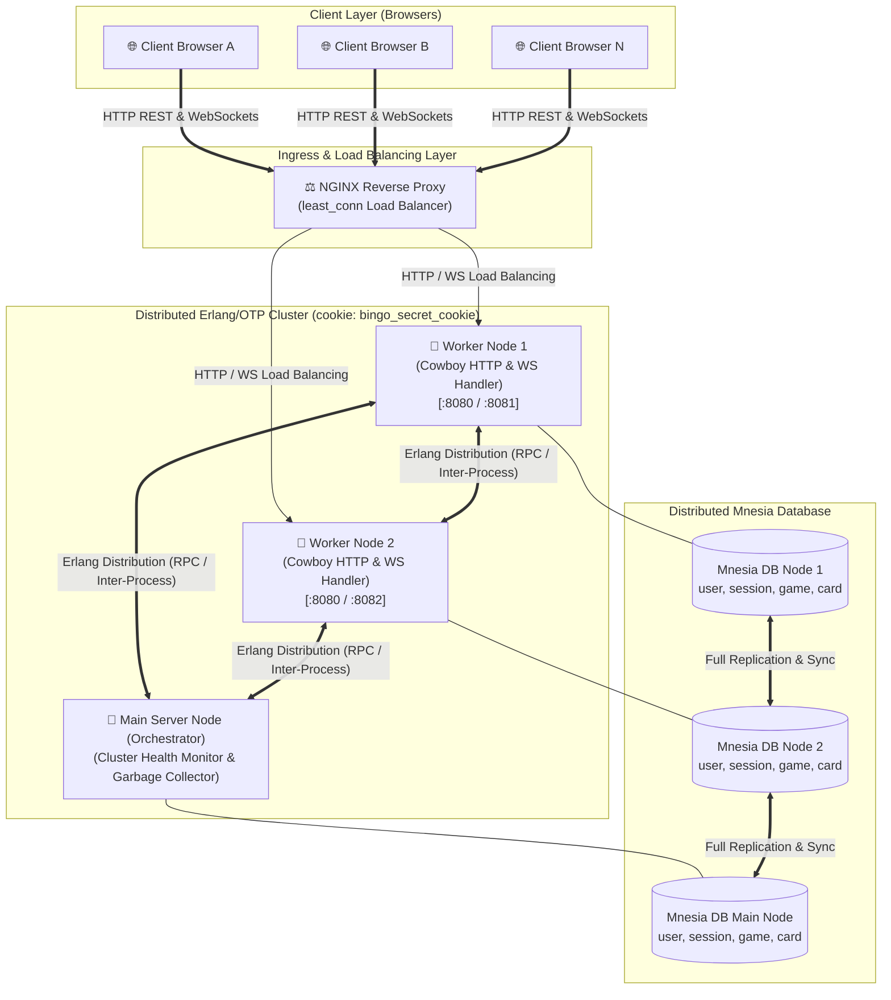
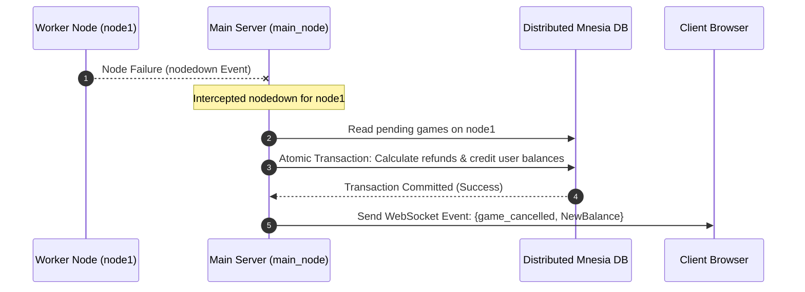

# 🎯 Distributed Real-Time Bingo Platform

[](https://www.erlang.org/)
[](https://erlang.org/doc/man/mnesia.html)
[](https://github.com/ninenines/cowboy)
[](https://nginx.org/)
[](#)

> **High-Availability, Fault-Tolerant, Multi-Node Real-Time Engine in Erlang/OTP**  
> *Developed as a core project for the Distributed Systems and Middleware Technologies (DSMT) course at the University of Pisa.*

---

## 📌 Executive Summary

This repository contains a full-stack, distributed **Multiplayer Real-Time Bingo Platform**, engineered using the **Actor Model** in Erlang/OTP.

The system handles concurrent players across multiple nodes via high-frequency **WebSocket connections**, guaranteeing:
- **ACID Data Consistency** powered by a distributed Mnesia database cluster.
- **Fault Tolerance & Self-Healing** with automated state recovery and atomic refunds upon node crash events.
- **Horizontal Scalability** leveraging dynamic load balancing with NGINX reverse proxies.
- **Enterprise-Grade Security** implementing PBKDF2-HMAC-SHA256 password hashing and secure HTTP-Only session cookies.

---

## 🛠️ Tech Stack & Architectural Pillars

| Component | Technology | Role & Architectural Patterns |
| :--- | :--- | :--- |
| **Core Engine** | `Erlang/OTP` | Actor Model concurrency, supervision trees, isolated `gen_server` per game room. |
| **Distributed DB** | `Mnesia DB` | Multi-node distributed shared-memory/disk DBMS with full ACID transaction support. |
| **Web Server & WS** | `Cowboy` | High-performance HTTP REST API & WebSocket server for full-duplex real-time messaging. |
| **Load Balancer** | `NGINX` | Reverse proxy using `least_conn` routing and transparent WebSocket protocol upgrades. |
| **JSON Processor** | `jsx` | High-throughput Erlang-to-Client JSON serialization/deserialization. |
| **Frontend UI** | `HTML5 / CSS3 / ES6+` | Reactive Vanilla JavaScript client with zero external dependencies and optimized grid rendering. |

---

## 📐 System Architecture

The architecture is decoupled into **3 distinct layers**: Client Layer, Ingress/Proxy Layer, and Distributed Core Cluster.

### 🌐 System Topology Diagram



---

## 🔬 Key Engineering Highlights & Design Decisions

### ⚡ 1. Actor-Based Concurrency (`gen_server`)
Every active game room is spawned as an **isolated Erlang process** (`game_server`), globally registered via `global:register_name(GameId, self())`.
- **Fault Isolation**: An anomaly within a single game room process will never crash other game servers or degrade the rest of the cluster.
- **Encapsulated State**: Game state (players, purchased cards, pot, drawn numbers, claimed winning combinations) is kept in thread-safe process memory.

### 🛡️ 2. Fault Tolerance & Disaster Recovery (Atomic Refund)
The `main_server` orchestrator continuously monitors cluster node health via `net_kernel:monitor_nodes(true)`.

**Node Failure Recovery Scenario (`nodedown`)**:
1. The `main_server` intercepts the node disconnection event.
2. Identifies all pending (waiting) games hosted on the failed node.
3. Triggers an **atomic Mnesia transaction** that:
   - Calculates exact card refunds for each player (10 coins per card).
   - Re-credits refunded amounts directly to the user's `user` record balance.
   - Removes the orphaned game record and broadcasts a cancellation event with the updated balance to connected clients.



### 💾 3. Distributed Data Model (Mnesia Storage Strategy)
The Mnesia database leverages complementary storage types to balance throughput and persistence:

| Table | Storage Type | Persistence Strategy | Rationale |
| :--- | :--- | :--- | :--- |
| `user` | `disc_copies` | Disk Persistent | Guarantees long-term persistence for user credentials, password hashes, and coin balances. |
| `session` | `ram_copies` | Replicated In-Memory | High-speed lookup for validating every HTTP and WebSocket request token. |
| `game` | `ram_copies` | Replicated In-Memory | Volatile and dynamic game states, synchronized across all cluster nodes in real time. |
| `card` | `ram_copies` | Replicated In-Memory | Bingo card grids per game room, automatically cleaned up upon game completion. |

### 🔐 4. Auth & Security Pipeline
- **Password Hashing**: Implements **PBKDF2-HMAC-SHA256** with 10,000 iterations and a cryptographically secure 16-byte random salt (`crypto:pbkdf2_hmac`).
- **Session Tokens**: Generates 128-bit strong random binary tokens encoded in Base64.
- **HTTP-Only Cookies**: Session tokens are delivered via `Set-Cookie` headers with `HttpOnly` flags to mitigate XSS risks.
- **Automatic Garbage Collection**: A recurring timer on `main_node` executes a Mnesia fold operation to delete sessions inactive for over 24 hours.

---

## 🎯 Game Mechanics & Server-Side Verification

The game engine enforces authentic Bingo rules with server-side validation on every draw:

1. **Bingo Cards**: Each card features a 3x5 grid containing 15 unique numbers between 1 and 90.
2. **Pot & Economy**: Cards cost **10 coins** each. 100% of collected card fees are added to the game pot.
3. **Game Loop**:
   - Lobby State → Card Purchase → All Players Click "Ready" → Countdown → Drawing Loop (1 number every $N$ seconds).
4. **Winning Combinations**:
   - **Ambo**: 2 matched numbers on a single row.
   - **Terno**: 3 matched numbers on a single row.
   - **Quaterna**: 4 matched numbers on a single row.
   - **Cinquina**: 5 matched numbers on a single row.
   - **Bingo**: All 15 numbers matched on the card.
5. **Anti-Double Claim**: `#game.won_combinations` tracks claimed prizes server-side to block duplicate or fraudulent claims in the same game.

---

## 🗂️ Project Structure

```text
DSMT-BingoGame/
├── client/                     # Frontend Web Application
│   ├── index.html              # Reactive HTML5 UI (Login, Register, Lobby, Bingo Board)
│   ├── style.css               # Modern CSS System (Glassmorphism, animations)
│   └── app.js                  # Client Logic (WebSocket Lifecycle, DOM state, Events)
├── server/                     # Distributed Backend Core (Erlang/OTP)
│   ├── include/
│   │   └── bingo_records.hrl   # Mnesia Record Definitions (user, session, game, card)
│   ├── src/
│   │   ├── bingo_app.erl       # Cowboy Application Bootstrap & Router Config
│   │   ├── main_server.erl     # GenServer Orchestrator, Node Monitor & Fault Manager
│   │   ├── game_server.erl     # GenServer FSM managing individual game loops
│   │   ├── db_manager.erl      # Mnesia DB Cluster & Distributed Schema Builder
│   │   ├── http_handler.erl    # Cowboy HTTP REST API Handler (Login / Register)
│   │   └── ws_handler.erl      # Cowboy WebSocket Handler for real-time messaging
│   ├── Makefile                # Build toolchain for Erlang sources
│   └── start_cluster.sh        # Bash script for local cluster startup
├── nginx.conf                  # Load Balancer & Reverse Proxy Configuration
├── commands.txt                # Reference CLI commands for multi-node clusters
└── README.md                   # Project Documentation
```

---

## 💻 Installation & Deployment Guide

### 📋 Prerequisites
- **Erlang/OTP 24+** (with `mnesia`, `crypto`, `cowboy`, `jsx`)
- **NGINX** (for load balancing)
- **GNU Make** and **Bash Shell**

---

### 🚀 1. Local Quickstart (3-Node Cluster)

1. **Clone the repository**:
   ```bash
   git clone https://github.com/Dariobande/DSMT-BingoGame.git
   cd DSMT-BingoGame
   ```

2. **Compile the Erlang backend**:
   ```bash
   cd server
   make clean-all
   make
   ```

3. **Launch the distributed cluster**:
   ```bash
   chmod +x start_cluster.sh
   ./start_cluster.sh
   ```
   *This script automatically launches `node1@localhost` (port 8081), `node2@localhost` (port 8082), and `main_node@localhost`.*

4. **Access the Application**:
   Open `client/index.html` in your browser or serve it via a static HTTP web server.

---

### 🌐 2. Multi-Machine Distributed Deployment (Network Topology)

To run the cluster across separate physical or cloud instances:

```text
[ Node 1: 10.2.1.9:8080 ] ──┐
[ Node 2: 10.2.1.10:8080 ] ─┼──> [ NGINX Proxy: 10.2.1.36:80 ] <── [ Clients ]
[ Main Node: 10.2.1.35 ]  ──┘
```

1. **Cowboy Node 1** (`10.2.1.9`):
   ```bash
   erl -name node1@10.2.1.9 -setcookie bingo_secret_cookie \
       -pa ebin/ -pa deps/jsx/ebin -pa deps/cowboy/ebin -pa deps/cowboy/deps/cowlib/ebin -pa deps/cowboy/deps/ranch/ebin \
       -eval 'bingo_app:start(8080, "10.2.1.35").'
   ```

2. **Cowboy Node 2** (`10.2.1.10`):
   ```bash
   erl -name node2@10.2.1.10 -setcookie bingo_secret_cookie \
       -pa ebin/ -pa deps/jsx/ebin -pa deps/cowboy/ebin -pa deps/cowboy/deps/cowlib/ebin -pa deps/cowboy/deps/ranch/ebin \
       -eval 'bingo_app:start(8080, "10.2.1.35").'
   ```

3. **Main Server Node** (`10.2.1.35`):
   ```bash
   erl -name main_node@10.2.1.35 -setcookie bingo_secret_cookie \
       -pa ebin/ -pa deps/jsx/ebin -pa deps/cowboy/ebin -pa deps/cowboy/deps/cowlib/ebin -pa deps/cowboy/deps/ranch/ebin \
       -eval "main_server:start_link(['node1@10.2.1.9', 'node2@10.2.1.10'])."
   ```

4. **NGINX Reverse Proxy** (`10.2.1.36`):
   Apply `nginx.conf` and reload NGINX:
   ```bash
   sudo cp nginx.conf /etc/nginx/nginx.conf
   sudo nginx -s reload
   ```

---

## 🔌 API & WebSocket Protocol Reference

### 1. HTTP REST API

#### `POST /api/register`
- **Request Body**:
  ```json
  {
    "username": "player1",
    "password": "SecretPassword123!",
    "confirm_password": "SecretPassword123!"
  }
  ```
- **Response (200 OK)**:
  ```json
  { "status": "ok", "message": "registered" }
  ```

#### `POST /api/login`
- **Request Body**:
  ```json
  { "username": "player1", "password": "SecretPassword123!" }
  ```
- **Response Header**: `Set-Cookie: session_token=...; Path=/; HttpOnly`
- **Response Body**:
  ```json
  { "status": "ok", "balance": 100 }
  ```

---

### 2. WebSocket Framing Protocol (`/ws`)

#### Client Actions ➔ Server

```json
// Create Room
{ "action": "create_game" }

// Join Room
{ "action": "join_game", "game_id": "game_12345" }

// Buy Bingo Card
{ "action": "buy_card" }

// Set Player Ready
{ "action": "set_ready" }

// Claim Prize
{ "action": "claim_win", "type": "ambo" | "terno" | "quaterna" | "cinquina" | "bingo" }
```

#### Server Events ➔ Client

```json
// Game Creation Response
{ "event": "game_created", "game_id": "game_12345" }

// Card Issued
{ "event": "card_bought", "card": [5, 12, 23, 34, 45, 56, 67, 78, 89, 2, 19, 41, 60, 72, 88] }

// Number Drawn
{ "event": "number_drawn", "number": 42 }

// Winner Broadcast
{ "event": "win_announced", "type": "cinquina", "winner": "player1", "prize": 50 }

// Automatic Refund / Cancellation
{ "event": "game_cancelled", "new_balance": 110 }
```

---

## 👨‍💻 Author & Contacts

**Dario Bandecchi**  
- **GitHub**: [@Dariobande](https://github.com/Dariobande)  
- **Course**: Distributed Systems and Middleware Technologies (DSMT)  
- **Institution**: University of Pisa  

---

## 📜 License

This project is licensed under the **MIT License**. See `LICENSE` for details.
